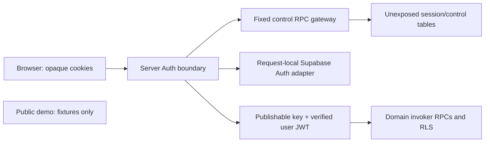

# ADR0006: Runtime Auth control plane

Date: 2026-11-04. Status: **proposed; owner privilege-boundary approval pending**.

Builder/API review completed 2026-11-05. The protocol refinements below are implementation decisions for the next reviewed source diff, not additional product questionnaires or deployed behavior.

This closes the runtime design gap between the approved opaque server session and user-context Supabase access. Policy and crypto primitives are published; a session store, OAuth adapter, routes and real Auth/RLS integration are not implemented. No configuration, key or hosted data is changed by this document.

## Proposed boundary and alternatives

An opaque-cookie lookup happens before the server has the user's access JWT. It needs a separate control-plane capability; a normal user client cannot perform that initial lookup.

| Choice | Scope and tradeoff | Recommendation |
| --- | --- | --- |
| A: server-only Supabase secret key with a fixed control-RPC gateway | Fits the existing HTTP/RPC architecture without a new runtime SQL driver. The credential remains broad and bypasses RLS; an RPC allowlist in code does not make it function-scoped | Proposed M1 direction, requiring explicit acceptance of that credential risk |
| B: custom restricted Postgres login via the shared pooler | Database-enforced credential scope can be narrower. Requires a new runtime SQL/pool/role/password lifecycle and compatibility profile | Alternative if broad-key risk is rejected; separate reviewed runtime SQL decision |

Neither route requests a paid service. Actual project eligibility, capacity, SDK/CLI pins and configuration must be verified before activation. Use current publishable/secret key types, not an implicit new legacy-key dependency. [Supabase key privileges](https://supabase.com/docs/guides/getting-started/api-keys), [connection options](https://supabase.com/docs/guides/database/connecting-to-postgres).

`SessionControlRepository` alone holds the server secret capability. It accepts closed inputs and maps to fixed function names; no client-selected table, function, SQL, schema or URL. Ordinary study repositories receive the verified user JWT and publishable key, never the control secret. Public/demo/untrusted preview builds receive neither personal credentials nor encryption keys. The test-only pg harness remains outside runtime.

Control tables stay in an unexposed schema. If using choice A, thin control RPCs live in an already exposed API schema, preferably fixed public wrappers to avoid a new schema-exposure setting. They use invoker execution and explicit service_role grants; revoke PUBLIC/anon/authenticated execution atomically in the migration. Private-schema functions are not assumed directly callable through PostgREST. The service credential still has broad platform power despite this code boundary. [Function permissions](https://supabase.com/docs/guides/database/functions).

## Proposed records and invariants

| Record | Fields/invariants |
| --- | --- |
| Owner control | Owner UUID, approved Auth-subject UUID, active flag, current dataset epoch and control version; one active owner; no email/metadata-derived grant |
| App session | Session UUID, unique secret hash, owner/Auth subject, verified upstream session UUID, browser binding, created/activity/reauth/revoked times, credential state, token envelope, access expiry, token version and refresh attempt/lease |
| Browser binding | Unique purpose-separated secret hash, generation, expiry, optional current session; no owner authority by itself |
| CSRF proof | Purpose-separated token hash, binding/generation, purpose, exact presented-cookie fingerprint or explicit absence, issued/expiry times, optional session and logout receipt |
| OAuth attempt | Binding/generation, purpose, prior session if any, flow-cookie hash, separately encrypted PKCE verifier, state, expiry and resulting session |
| Revocation work | Bound session, encrypted cleanup credential when available, bounded state/attempt/deadline and sanitized error category |

Only one nonrevoked app session may map to an upstream session UUID. Use a partial uniqueness constraint while retaining revoked history; do not use a global uniqueness constraint that prevents session rotation. Owner/session/subject relationships require database constraints and current-state checks. Authoritative times come from the database. Control records and credentials are excluded from dataset replacement and recovery exports.

PKCE verifier, browser binding and CSRF secrets need distinct purpose-bound formats; never disguise them as access/refresh tokens to reuse the existing token envelope. Session/credential keys remain separate from data exports and public builds. No actual owner Auth UUID or key value is known/configured by this proposal.

Proposed cookies: `__Host-jls-session`, `__Host-jls-browser`, `__Host-jls-oauth`; Secure, HttpOnly, SameSite=Lax, Path=/, no Domain. Auth development therefore requires HTTPS under the current request policy.

## Bootstrap and login

1. Approve the exact nonproduction environment, canonical HTTPS origins and callbacks. The Google-to-Supabase callback and Supabase-to-app callback are distinct, exact URLs; no wildcard preview redirect.
2. The designated learner enrolls through a controlled Google flow. Before an owner binding exists, personal access remains denied.
3. An operator verifies the resulting Auth user/Google identity and obtains approval of the actual Auth UUID before atomically binding owner and dataset. Email may assist private verification but never authorizes a request. First visitor cannot become owner.
4. A fresh login must match the established UUID. Do not delete rejected Auth users or activate signup hooks incidentally.

Proposed `POST /api/v1/auth/csrf` requires exact Origin but no earlier proof. It issues a short-lived browser-bound proof with explicit purpose and exact presented session-cookie fingerprint, including absence. It grants no owner authority. Mutation-purpose issuance requires a valid owner session; login/logout issuance does not require an active owner/dataset. Tokens stay out of URLs and persistent browser storage. A malformed cookie is bounded and fingerprinted as malformed, never accepted as a session secret.

Proposed `POST /api/v1/auth/login` requires login proof and fixed return target. Permit one outstanding OAuth attempt per binding. Persist its verifier before returning a 303 to the allowlisted authorization URL. Supabase owns provider-facing OAuth state; do not override it with an application query parameter. The app's flow cookie, attempt and server verifier bind its callback. [PKCE behavior](https://supabase.com/docs/guides/auth/sessions/pkce-flow).

The callback claims an unexpired attempt once, exchanges the code outside database locks, verifies the returned user/issuer/audience/expiry/subject/upstream session, then rechecks browser generation and owner under locks before inserting the app session and encrypted credentials. Emit the cookie only after confirmed commit. Discard provider Google tokens; retain only needed Supabase credentials, encrypted.

Unknown code-exchange outcome closes the attempt and requires a fresh login; never blindly exchange a one-use code again. Unknown session-commit acknowledgement is resolved by attempt identity. A hash cannot recover a lost raw bearer; if the committed session's cookie was never delivered, revoke that unacknowledged session and restart. Late callback/cookie delivery must not revive a database-revoked session. Upstream orphan cleanup is best effort, with explicit failure state.

## Request authorization and transaction races

Lookup and validate current owner/session/dataset and app expiry before decrypt/refresh. Create a user client only after verified subject and upstream session UUID match the stored binding. getSession/local decoded claims are not verification. /me discovers the current epoch without requiring a stale client epoch header.

The verified user JWT's session_id must map to exactly one currently authorized app session. User RLS must check this mapping, active owner, expiry, credential state and dataset; authenticated role alone is insufficient. Domain mutations additionally lock/revalidate the authorization controls through commit before operation/aggregate locks. A BFF lookup alone cannot close the logout-versus-mutation race.

Prefer invoker authorization helpers with minimal column grants. If a private definer helper is necessary, its exact ownership/search_path/grants and auth.uid/session_id checks require separate SQL security review. Never add a public definer shortcut to cure a permission error. Actual auth.sessions checks/grants require Supabase-specific tests; a generic PG fixture is not that evidence. [Session and signout limits](https://supabase.com/docs/guides/auth/sessions).

Global lock order: browser binding when needed, owner control, app sessions in UUID order, OAuth/CSRF/receipt records, domain operation/aggregate rows. Network/provider calls occur outside transactions. If logout commits first, subsequent domain mutation fails; otherwise the authorized mutation commits before logout. Already delivered bytes cannot be recalled.

## Refresh and logout

Refresh uses one durable claim/lease and expected token version. A competitor waits briefly and rereads, otherwise returns a temporary failure. Only the holder calls Auth; completion CAS checks attempt/version/lease and current unrevoked owner/session before replacing both encrypted tokens. Refresh does not change creation time, recent reauth or idle activity.

CAS protects database writes, not upstream rotating-token effects. Once transmission might have occurred, timeout, crash or lease expiry moves to uncertain/reauth-required; another worker may not steal the lease and resend the old rotating token. Late results are fenced and never restore a revoked session. Only demonstrably pre-transmission failures can be retried. Unavailable dependencies are never treated as confirmed absence.

Logout requires exact Origin and purpose-specific trusted browser/session binding, even for expired/revoked sessions. It does not require active owner, current dataset, upstream refresh or recent reauth. In one transaction revoke the presented session, invalidate refresh, close relevant pending OAuth attempts and retain a short logout receipt. Commit before clearing the session cookie; return204 only after confirmed local revocation/absence. Upstream signout uses local scope as bounded cleanup, never an implicit global signout.

The final transport/SQL contract must explicitly bind receipt and before/after browser generations: a repeated request returns its original result without advancing generation again; a newer login/session cannot be revoked by an old proof. A cleared cookie may match only the retained receipt of that exact operation. Anonymous logout needs an explicit absent-cookie proof. Missing cookie alone never bypasses CSRF. Unknown commit resolves from receipt, otherwise503; failed cookie deletion cannot restore database authority.

### Auth-action proof and generation decisions

Use a separate trusted Auth-action verification result for login/logout. Its discriminant covers purpose, proof/operation identity, browser binding, generation, presented-cookie fingerprint/absence and optional retained logout receipt. Do not manufacture a sentinel session UUID to reuse the owner mutation policy. Only a server verifier supplies this result; request JSON cannot assert verification.

An issued login/logout proof owns one stable operation identity. Store request fingerprint, binding ID, generation-before, generation-after, target session and committed outcome in its receipt. Normal owner mutation proofs can remain reusable within their TTL; domain operation identity is separate.

| Case at server processing | State transition/result |
| --- | --- |
| Fresh logout at generation g | Validate exact proof/cookie/binding, revoke its matched session, cancel that generation's pending OAuth, set binding generation g+1 and no current session, insert receipt atomically |
| Identical retry, old cookie still present | If receipt fingerprint matches and binding still has receipt's resulting generation/no newer session, return prior outcome and allow cookie expiration; no new generation increment |
| Identical retry after cookie clear | Allow absence only against that same committed receipt and unchanged resulting binding generation; do not reinterpret it as an anonymous fresh request |
| Anonymous logout from the start | Proof must explicitly bind absence; confirm no session/pending activation for that binding before recording the absence outcome |
| Newer generation/session, different cookie or expired proof without a retained valid receipt |403, no revocation or cookie-clear instruction for the newer state; obtain a current proof |
| Commit result unknown | Read by stable operation identity; unresolved503, never fabricated204 |

Set-Cookie delivery itself cannot be serialized by a database. A previously sent logout response may arrive after a later login response and clear the browser cookie; the server must not promise otherwise. The client serializes its Auth actions where possible; loss/reordering recovers through current-session verification or fresh login, while the database prevents restored authority.

### Lost-cookie delivery recovery

Add a separate app-session delivery state, unacknowledged/acknowledged. A successful request proving possession of the issued cookie can acknowledge delivery without extending idle time. The server does not infer browser receipt merely because it sent Set-Cookie.

For a completed callback retry, a matching valid resulting cookie may redirect without a new exchange or bearer issuance. Without that cookie, return an uncertain-sign-in/restart outcome and retire only a still-unacknowledged resulting session using CAS. Never revoke an already acknowledged newer session on that basis. A late old cookie may then fail safely and require fresh login. A new login rotates the browser's prior session under the same generation checks. No raw bearer is recovered from a stored hash.

Before calling logout, UI honors the approved Sync/Export-pending/Discard choice. Private caches clear after acknowledged logout; a security endpoint does not silently choose to discard unsent work.

## HTTP surface and deliberate pending decisions

| Proposed route | Success and constraints |
| --- | --- |
| POST /auth/csrf |200 short-lived proof/expiry; exact Origin, purpose-bound, no owner grant |
| POST /auth/login |303 allowlisted provider authorization URL; login proof, fixed return destination |
| GET /auth/callback |303 fixed same-origin target; one-use bound attempt and verified identity |
| GET /me |200 authenticated:true plus requestId/current datasetEpoch; no email/owner/session/Auth-subject/token fields |
| POST /auth/logout |204 empty; reject nonempty body; no domain idempotency key/ETag/client dataset prerequisite |

Prefix `/api/v1`. All outcomes private/no-store with sanitized Problems and request IDs; callback also no-referrer. No permissive CORS or provider error/query/token logging. The next contract diff must declare strict bodies, response schemas, cookie attributes, rate limits and internal stable operation identities; these routes are not implemented by this ADR.

/me polling, refresh, CSRF issuance, background reads and media requests do not extend idle lifetime. Successful foreground commands may advance activity while the session is still valid; an explicit foreground activity route, if needed, requires its own reviewed contract. Activity never grants XP or bypasses absolute expiry.

Recent OAuth identity verification is not proof that Google freshly challenged a password/factor; refresh or select_account alone does not qualify. Destructive replacement/deletion remains closed until a verified recent-reauth mechanism and its exact meaning are approved/tested. That gate does not block ordinary owner study routes.

### Privilege and refresh implementation constraints

| Surface | Proposed grant/check boundary for SQL review |
| --- | --- |
| Public control wrappers | Execute only for service_role; explicit PUBLIC/anon/authenticated revocation; no blanket public-schema USAGE revocation that breaks domain RPCs |
| Private credential columns | No anon/authenticated SELECT/UPDATE; control invoker has explicit underlying rights; never return tokens/hashes to public DTOs |
| Private authorization facts | If invoker helper is used, authenticated gets only necessary safe-column SELECT and harmless lock-token UPDATE where required, with explicit RLS/check policies; no active/epoch/token/owner reassignment rights |
| RLS dependencies | Keep authorization dependencies acyclic: session→owner; dataset/domain→session/owner. Session policies must not recursively call the domain authorization helper |
| Mutation helper | Lock/recheck current owner/session/dataset before domain operation locks; subject/session derive from validated user JWT, not request owner fields |
| Optional private definer | Only if invoker grants cannot satisfy the tested design; explicit minimal owner/search_path/grants, JWT subject/session checks and safe return shape; review before any apply |

Refresh states must be explicit: usable→prepared→sent-or-unknown→committed/uncertain/revoked. Persist a transmission-intent marker before the single Auth call; a failure to establish that marker prevents transmission. Lease expiry or process loss after possible transmission requires reauthentication, not another rotating-token call. A known same-worker pre-send validation failure may release its claim under CAS. SQL/token versions fence late completion; local and upstream session UUIDs stay distinct. Never copy a new response subject/session into the stored identity without verifying the expected binding.

Proposed budgets for later validation: RPC2s, lock250ms, Auth5s, request10s, refresh lease15s, proof15minutes, OAuth attempt10minutes. They are unmeasured technical targets. Client abort does not prove remote work was cancelled; mutating outcomes still require identity/CAS resolution.

## Delivery and acceptance sequence

1. Owner approves choice A's privilege boundary (or selects B); no secret/configuration is applied by that decision alone.
2. Prepare pinned SDK/CLI compatibility evidence, strict transport/contracts, migrations/functions/grants and fixture diff. Generate migration names using the approved pinned CLI, not a guessed filename.
3. Review source/SQL and execute disposable tests for role denial, direct row/object access, OAuth/CSRF failure, refresh unknown outcomes and logout/owner/epoch races. Generic PG success does not close actual Supabase Auth/PostgREST evidence.
4. Present exact nonproduction project/origin/callback/Google client configuration and secret names/locations, verified owner Auth UUID, key IDs/rotation/retention/rollback and current USD0 eligibility before hosted changes. No secret values in documents or chat.
5. Only after explicit hosted-change approval perform real Google/Auth/RLS/Storage tests. Human security, UAT and release gates remain separate; no claim of completed AC01/37/42.

Not yet verified/configured and required before runtime activation: exact grant/helper SQL, implemented anonymous/retry proof verifier, tested delivery/refresh/receipt transitions, SDK behavior/pins, actual Auth UUID and hosted origins. Source and fixture preparation can implement the specified decisions after boundary approval; exact SQL/configuration still receives its own review before apply. Destructive reauth remains separately closed until its mechanism is proved.
